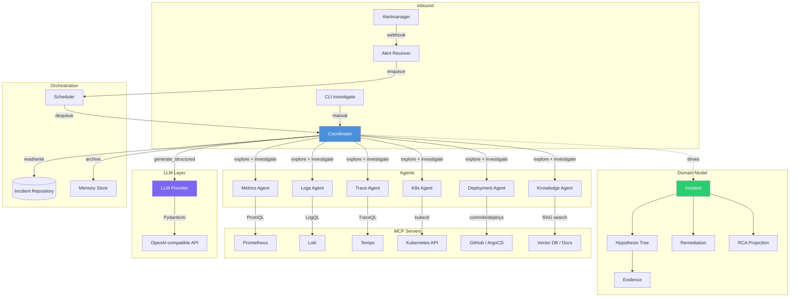

# Observability Agent

[](https://github.com/jagdeepm/observability-agent/actions/workflows/ci.yml)
[](https://www.python.org/downloads/)
[](LICENSE)

**AI-Native Cloud Observability Agent** — autonomous incident investigation for cloud-native infrastructure.

When an alert fires, the agent autonomously gathers telemetry from six observability sources, forms and tests a tree of root-cause hypotheses, produces an evidence-backed RCA with confidence scores, and recommends remediation — all while keeping a human in the loop for execution.



## How It Works

1. **Alert fires** → Alertmanager webhook or CLI creates an Incident
2. **Explore** → All 6 agents gather exploratory telemetry in parallel
3. **Hypothesize** → LLM reviews evidence and proposes a tree of root-cause hypotheses
4. **Investigate** → Each hypothesis gets targeted evidence from the most relevant source
5. **Evaluate** → LLM batch-evaluates all hypotheses (confirmed or refuted, with confidence scores)
6. **Prune** → Refuted branches are removed; confirmed branches are deepened with child hypotheses
7. **Converge** → Loop continues until no new hypotheses can be generated or max depth is reached
8. **RCA** → LLM produces a root cause analysis with a recommended remediation action
9. **Approve** → Human approves or rejects the remediation before execution

## Install

```bash
git clone https://github.com/jagdeepm/observability-agent.git
cd observability-agent
python3 -m venv .venv && source .venv/bin/activate
pip install -e ".[dev]"
```

Requires Python ≥ 3.12.

## Quick Start

### Mock investigation (offline, no LLM API key)

```bash
observability-agent investigate \
  --service checkout \
  --alert "latency > 500ms" \
  --severity critical \
  --mock-llm
```

Uses canned mock responses. Prints a full RCA report to stdout.

### Real investigation (requires LLM API key)

```bash
cp .env.example .env    # then fill in LLM_BASE_URL, LLM_API_KEY, LLM_MODEL
set -a && source .env && set +a

observability-agent investigate \
  --service checkout \
  --alert "latency > 500ms" \
  --severity critical
```

Any OpenAI-compatible endpoint works — OpenAI, a LiteLLM proxy, or a local model server. The `task` targets load `.env` on their own; only direct CLI invocations need the `source` above.

### API server (Alertmanager webhook)

```bash
observability-agent serve --port 8000
```

Endpoints:

| Method | Path | Description |
|---|---|---|
| `GET` | `/health` | Health check with queue stats |
| `POST` | `/alerts` | Alertmanager webhook receiver |
| `GET` | `/incidents` | List active incidents |
| `GET` | `/incidents/{id}` | Incident details + RCA |
| `POST` | `/incidents/{id}/resolve` | Manually resolve an incident |
| `GET` | `/memory/search?q=...` | Search archived incidents |
| `GET` | `/memory/incidents` | List archived incidents |
| `GET` | `/memory/incidents/{id}` | Archived incident details |

## Architecture

### Bounded Contexts

| Context | Role | Key Entities |
|---|---|---|
| **Alerting** | Inbound signals from alert sources | `Alert`, `AlertSource` |
| **Investigation** | Core domain — incident lifecycle & hypothesis-driven RCA | `Incident` (aggregate), `Hypothesis`, `Evidence`, `Remediation` |
| **Topology** | Service dependency graph | `Node`, `Edge` |
| **Memory** | Archived incident snapshots for similarity search | `ResolvedIncident` |
| **Knowledge/RAG** | Documentation retrieval | (infrastructure only) |

### Coordinator Workflow

The Coordinator is a **rule-based state machine with LLM-filled content**. The workflow structure is deterministic; the LLM is called only for content generation.

```
open → acknowledge → explore → generate hypotheses
    → investigate (loop)
        ├── gather targeted evidence
        ├── evaluate hypotheses (LLM)
        ├── prune refuted branches
        └── deepen confirmed leaves (LLM)
    → produce RCA (LLM) → pending_approval
```

### Incident State Machine

```
open → investigating → rca_produced → pending_approval → remediating → resolved
  ↘        ↘                                                 ↘ failed (→ investigating)
false_positive  ↘
            closed (manual, from any non-terminal state)
```

### Hypothesis Lifecycle

```
proposed → investigating → confirmed
                         → refuted
```

When a parent hypothesis is refuted, all children are cascade-refuted (pruning).

### Agent Pipeline

Each of the six agents follows the same pattern:

```
Natural language query → LLM translates to domain-specific query language
                       → MCP client executes the query
                       → deterministic analysis computes the facts
                       → LLM summarizes the results
                       → Evidence object returned
```

### Arithmetic in code, language in the LLM

Metrics, logs, and traces pass through [`analysis.py`](src/observability_agent/analysis.py) before the LLM sees them. Percentiles, z-score anomaly detection, exact error counts, and the slowest span by self time are computed in Python — the LLM is asked only to put those facts into a sentence.

```python
# before — the LLM eyeballs a truncated dict and guesses
prompt=f"Loki results:\n{str(raw)[:4000]}"          # → error_count: int, from the LLM

# after — the LLM is handed counted facts
"Log analysis: 415 lines, 415 error-level, 2 distinct messages."
"  [ERROR] ×412 (12:00:03 → 12:07:41): OOMKilled container checkout"
```

The computed values travel on `Evidence.signals` and are rendered into every Coordinator prompt, so a hypothesis is confirmed or refuted against a measured value rather than a paraphrase of one. See [ADR-007](docs/adr/007-deterministic-evidence-precompute.md).

| Agent | Source | Query Language | MCP Server |
|---|---|---|---|
| `MetricsAgent` | Prometheus | PromQL | Prometheus HTTP API |
| `LogsAgent` | Loki | LogQL | Loki HTTP API |
| `TraceAgent` | Tempo | TraceQL | Tempo HTTP API |
| `KubernetesAgent` | Kubernetes | kubectl | Kubernetes API |
| `DeploymentAgent` | GitHub/ArgoCD | commits/diffs | GitHub/ArgoCD API |
| `KnowledgeAgent` | Documentation | RAG search | Vector DB |

## Project Structure

```
src/observability_agent/
├── domain/
│   └── models.py              # Incident, Hypothesis, Evidence, Remediation, Alert, Node, Edge
├── coordinator/
│   ├── engine.py              # Coordinator — investigation loop
│   ├── outputs.py             # LLM structured output Pydantic models
│   └── prompts.py             # Progressive context prompt templates
├── agents/
│   ├── protocols.py           # Agent callable protocols + MockAgent
│   ├── metrics.py             # MetricsAgent (Prometheus)
│   ├── logs.py                # LogsAgent (Loki)
│   ├── traces.py              # TraceAgent (Tempo)
│   ├── kubernetes.py          # KubernetesAgent
│   ├── deployment.py          # DeploymentAgent (GitHub/ArgoCD)
│   └── knowledge.py           # KnowledgeAgent (RAG)
├── mcp/
│   ├── prometheus.py          # Prometheus HTTP client
│   ├── loki.py                # Loki HTTP client
│   ├── tempo.py               # Tempo HTTP client
│   ├── kubernetes.py          # Kubernetes API client
│   ├── deployment.py          # GitHub/ArgoCD client
│   └── documentation.py       # Vector DB / RAG client
├── infrastructure/
│   ├── llm_provider.py        # LLMProvider protocol + PydanticAI + MockLLMProvider
│   ├── repository.py          # IncidentRepository protocol + InMemoryIncidentRepository
│   └── scheduler.py           # Async worker pool with concurrency control
├── api/
│   └── alert_receiver.py      # Alertmanager webhook + REST API
├── memory/
│   └── store.py               # MemoryStore — archived incident search
├── cli/
│   └── main.py                # CLI entry point
└── __init__.py
```

## Configuration

| Env Var | Default | Description |
|---|---|---|
Copy [`.env.example`](.env.example) to `.env` and edit it. Every `task` target loads `.env` automatically; a variable exported in your shell takes precedence, so CI can inject secrets without a file.

| Env Var | Default | Description |
|---|---|---|
| `LLM_MODEL` | `openai:gpt-4o` | Model identifier. `provider:model` strips the prefix; anything else passes through verbatim |
| `LLM_API_KEY` | `""` | API key for the LLM provider |
| `LLM_BASE_URL` | `""` | Base URL for OpenAI-compatible endpoints (include `/v1`) |
| `LLM_MOCK` | `false` | Use `MockLLMProvider` (offline dev; prefer `serve --mock-llm`) |
| `PROMETHEUS_URL` | `http://localhost:9090` | Prometheus query API |
| `LOKI_URL` | `http://localhost:3100` | Loki query API |
| `TEMPO_URL` | `http://localhost:3200` | Tempo query API |
| `MAX_CONCURRENT_INVESTIGATIONS` | `3` | Max concurrent Coordinator runs |
| `STALE_THRESHOLD_HOURS` | `24` | Hours before an investigation is flagged stale |

## Testing

```bash
pytest tests/ -v -m "not e2e"
```

93 tests covering:
- **Domain model** — state machines, hypothesis tree, RCA projection, remediation lifecycle
- **Coordinator** — full lifecycle, exploratory evidence, hypothesis generation/evaluation, pruning, agent failure, save-after-each-step
- **Metrics / Logs / Traces agents** — NL→query translation, error handling, and the computed signals from deterministic analysis
- **Scheduler** — enqueue, concurrency cap, critical priority, retry on failure
- **Alert Receiver** — webhook handling, alert grouping, incident creation
- **Memory Store** — archive, search, retrieval
- **E2E fault helpers** — flagd flag flipping and reset, without a cluster

All external dependencies are mocked. Tests run in < 1 second with no network calls.

### Demo

```bash
python tests/test_coordinator.py
```

Runs a full mock investigation from alert to RCA with assertions.

### End-to-End

A full e2e harness deploys the agent into a local [Kind](https://kind.sigs.k8s.io/) cluster alongside `kube-prometheus-stack`, Loki, Tempo, and the [OpenTelemetry Astronomy Shop](https://github.com/open-telemetry/opentelemetry-demo) demo. Faults come from the demo's own flagd feature flags, so the failures are real — the service genuinely errors, genuinely logs, genuinely shows up in traces. The tests then assert that Prometheus fires an alert and the agent autonomously produces an RCA.

```bash
task env-init   # create .env, then fill in your LLM settings
task all        # cluster → monitoring → loki → tempo → demo → agent → tests
task status     # what's currently running
task teardown   # delete the cluster
```

Beyond RCA shape, the e2e tests assert on **computed signals** — that `error_count`, `p95` and `slowest_self_ms` appear on the Evidence after a real fault. Those come from `analysis.py`, which falls back silently to truncation on an unfamiliar payload shape; a live stack is the only place that fallback is detectable.

Requires Kind, Helm, [Task](https://taskfile.dev/), and Docker. See [`docs/e2e-testing.md`](docs/e2e-testing.md) for the full guide.

## Architecture Decision Records

- [ADR-001](docs/adr/001-pydantic-domain-models.md) — Pydantic v2 for domain models and structured outputs
- [ADR-002](docs/adr/002-hypothesis-tree-rca-projection.md) — Hypothesis tree as investigation model with RCA as projection
- [ADR-003](docs/adr/003-rule-based-coordinator-llm-content.md) — Rule-based coordinator with LLM-filled content
- [ADR-004](docs/adr/004-agent-protocol-pattern.md) — Agent protocol pattern for observability sources
- [ADR-005](docs/adr/005-mock-everything-testing.md) — Mock-everything testing strategy
- [ADR-006](docs/adr/006-multi-cluster-from-day-one.md) — Multi-cluster from day one
- [ADR-007](docs/adr/007-deterministic-evidence-precompute.md) — Deterministic pre-compute of telemetry evidence

## Contributing

Issues and PRs are welcome — see [CONTRIBUTING.md](CONTRIBUTING.md) for setup, test expectations, and the two design constraints (deterministic coordinator, mock-everything tests) that shape the codebase.

## License

[MIT](LICENSE)